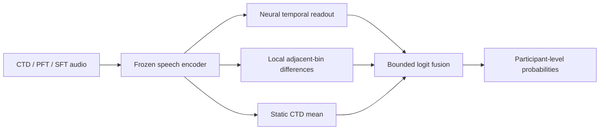
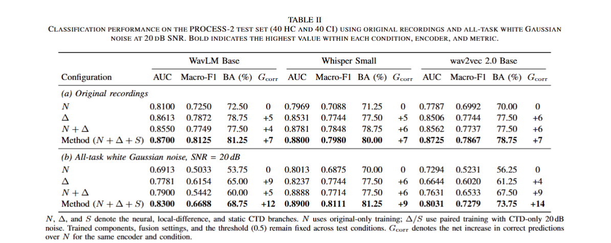

# Combining Local Temporal Differences and Static Representations for Speech-Based Cognitive Impairment Detection

Research code for an audio-only framework that combines neural, local-difference, and static readouts of frozen pretrained speech representations.

[Main results](#main-results-table-ii) · [Method](#method) · [Installation](#installation) · [Reproduction](#reproduction) · [Data](docs/DATA.md) · [Implementation](docs/METHOD.md) · [Exploratory extension](docs/EVENT_EXTENSION.md) · [Validation](docs/VALIDATION.md)

## Overview

The framework processes Cookie Theft Description (CTD), Phonemic Fluency (PFT), and Semantic Fluency (SFT) recordings at the participant level. A single frozen encoder is used in each experiment.

| Component | Representation | Training |
|---|---|---|
| Neural readout, N | Shared temporal convolution, duration-weighted pooling, and task-specific classifiers | Original recordings; three-seed probability ensemble |
| Local-difference readout, Delta | Duration-weighted RMS of adjacent-bin differences, concatenated across tasks | Original/CTD-noisy pairs with logit consistency |
| Static readout, S | Duration-weighted CTD mean | Original/CTD-noisy pairs with logit consistency |

The release includes the main binary and three-class pipelines, matched statistical baselines, within-context permutation controls, and augmentation-only consistency controls. The exploratory event descriptors and their block-normalized classifier are separate modules.



## Main results (Table II)

Table II reports participant-level classification on the PROCESS-2 test set (40 HC and 40 CI), using original recordings and all-task white Gaussian noise at 20 dB SNR.

- **Improved classification across three encoders.** The full framework achieves the highest reported AUC, Macro-F1, and balanced accuracy among the four listed branch configurations for every encoder under both evaluation conditions.
- **Gains over the neural-only configuration.** On original recordings, AUC increases by 0.0600–0.0938, with seven additional correct predictions per encoder. Under all-task noise, the full framework makes 12, 9, and 14 additional correct predictions for WavLM, Whisper, and wav2vec 2.0, respectively.



<details>
<summary>View Table II values as text</summary>

**(a) Original recordings**

| Encoder | Configuration | AUC | Macro-F1 | BA (%) | Gcorr |
|---|---|---:|---:|---:|---:|
| WavLM Base | N | 0.8100 | 0.7250 | 72.50 | 0 |
| WavLM Base | Δ | 0.8613 | 0.7872 | 78.75 | +5 |
| WavLM Base | N + Δ | 0.8550 | 0.7749 | 77.50 | +4 |
| WavLM Base | **Full (N + Δ + S)** | **0.8700** | **0.8125** | **81.25** | **+7** |
| Whisper Small | N | 0.7969 | 0.7088 | 71.25 | 0 |
| Whisper Small | Δ | 0.8531 | 0.7744 | 77.50 | +5 |
| Whisper Small | N + Δ | 0.8781 | 0.7848 | 78.75 | +6 |
| Whisper Small | **Full (N + Δ + S)** | **0.8800** | **0.7980** | **80.00** | **+7** |
| wav2vec 2.0 Base | N | 0.7787 | 0.6992 | 70.00 | 0 |
| wav2vec 2.0 Base | Δ | 0.8506 | 0.7744 | 77.50 | +6 |
| wav2vec 2.0 Base | N + Δ | 0.8562 | 0.7737 | 77.50 | +6 |
| wav2vec 2.0 Base | **Full (N + Δ + S)** | **0.8725** | **0.7867** | **78.75** | **+7** |

**(b) All-task white Gaussian noise, SNR = 20 dB**

| Encoder | Configuration | AUC | Macro-F1 | BA (%) | Gcorr |
|---|---|---:|---:|---:|---:|
| WavLM Base | N | 0.6913 | 0.5033 | 53.75 | 0 |
| WavLM Base | Δ | 0.7781 | 0.6154 | 65.00 | +9 |
| WavLM Base | N + Δ | 0.7900 | 0.5442 | 60.00 | +5 |
| WavLM Base | **Full (N + Δ + S)** | **0.8300** | **0.6688** | **68.75** | **+12** |
| Whisper Small | N | 0.8013 | 0.6875 | 70.00 | 0 |
| Whisper Small | Δ | 0.8237 | 0.7744 | 77.50 | +6 |
| Whisper Small | N + Δ | 0.8888 | 0.7714 | 77.50 | +6 |
| Whisper Small | **Full (N + Δ + S)** | **0.8900** | **0.8111** | **81.25** | **+9** |
| wav2vec 2.0 Base | N | 0.7294 | 0.5231 | 56.25 | 0 |
| wav2vec 2.0 Base | Δ | 0.6644 | 0.6020 | 61.25 | +4 |
| wav2vec 2.0 Base | N + Δ | 0.7631 | 0.6533 | 67.50 | +9 |
| wav2vec 2.0 Base | **Full (N + Δ + S)** | **0.8031** | **0.7279** | **73.75** | **+14** |

Bold indicates the highest value within each condition, encoder, and metric. Gcorr is the net increase in correct predictions over N for the same encoder and condition.

</details>

N, Δ, and S denote the neural, local-difference, and static CTD branches. N uses original-only training; Δ/S use paired training with CTD-only 20-dB noise. Trained components, fusion settings, and the 0.5 decision threshold remain fixed across test conditions. These are the manuscript's fixed-split results; release validation is documented [separately](docs/VALIDATION.md).

## Method

Recordings are encoded in independent 10-second contexts and pooled into 2-second bins. All 12 Transformer-layer outputs are retained before constructing branch inputs.

For each valid adjacent pair within one context, the difference descriptor uses

$$
d_j = \left(\frac{\sum_t w_t(h_{t+1,j}-h_{t,j})^2}{\sum_t w_t}\right)^{1/2},
\qquad w_t=\min(\ell_t,\ell_{t+1}).
$$

Binary predictions use the fixed fusion rule

$$
\widehat p = \sigma\left(z_\Delta + 2\tanh(z_N/4)+\tanh(z_S)\right).
$$

The paired linear objective combines supervised classification, L2 regularization, and a squared logit-consistency term. The encoder is never fine-tuned. See [implementation details](docs/METHOD.md) for normalization order, empty-bin handling, loss scaling, and the multiclass extension.

## Installation

The validated research environment uses Python 3.10 and PyTorch 2.9.1. Create an isolated environment and install one PyTorch build before installing this package.

```bash
python -m venv .venv
source .venv/bin/activate

# CPU
python -m pip install torch==2.9.1 --index-url https://download.pytorch.org/whl/cpu

# Install the research package and pinned dependencies.
python -m pip install -e .
```

On Windows PowerShell, activate the environment with `.\.venv\Scripts\Activate.ps1`. For the recorded CUDA 12.6 build, replace the CPU installation command with:

```bash
python -m pip install torch==2.9.1 --index-url https://download.pytorch.org/whl/cu126
```

Check the installation without downloading models or clinical data:

```bash
python -m unittest discover -s tests -v
python -m speech_ci smoke --output artifacts/smoke
```

The smoke command runs short binary and three-class workflows on synthetic features. It is an execution check, not a paper experiment.

## Data and encoders

PROCESS-2 must be obtained separately through its [official access process](https://huggingface.co/datasets/CognoSpeak/PROCESS-2). This source release contains no recordings, transcripts, clinical metadata, participant lists, derived participant features, or trained checkpoints.

| CLI encoder name | Pretrained checkpoint |
|---|---|
| `wavlm` | [microsoft/wavlm-base](https://huggingface.co/microsoft/wavlm-base) |
| `whisper_small_multi` | [openai/whisper-small](https://huggingface.co/openai/whisper-small) |
| `wav2vec2` | [facebook/wav2vec2-base](https://huggingface.co/facebook/wav2vec2-base) |

Whisper uses the multilingual **Small encoder**, not the English-only checkpoint or decoder. wav2vec 2.0 uses the base pretraining checkpoint, not a CTC fine-tune.

The [data guide](docs/DATA.md) describes the expected local layout. Generated artifacts belong under the ignored `artifacts/` directory.

## Reproduction

### 1. Reconstruct the participant split

```bash
python -m speech_ci split --data-root data/PROCESS-2 --output artifacts/split.json
```

This retains the official TRAIN320/TEST80 partition and splits TRAIN320 into 256 fitting and 64 validation participants using seed 61, stratified by HC/MCI/dementia. No participant identifiers or labels are included in the repository.

### 2. Extract features

The following example uses WavLM. Repeat it with the other encoder names and separate cache/model directories.

```bash
python -m speech_ci download --encoder wavlm --output models/wavlm

python -m speech_ci extract --data-root data/PROCESS-2 --split-file artifacts/split.json --cache-root artifacts/cache --encoder wavlm --model-path models/wavlm --split train --view original --device cuda
python -m speech_ci extract --data-root data/PROCESS-2 --split-file artifacts/split.json --cache-root artifacts/cache --encoder wavlm --model-path models/wavlm --split fit --view fit20 --device cuda
python -m speech_ci extract --data-root data/PROCESS-2 --split-file artifacts/split.json --cache-root artifacts/cache --encoder wavlm --model-path models/wavlm --split test --view original --device cuda
python -m speech_ci extract --data-root data/PROCESS-2 --split-file artifacts/split.json --cache-root artifacts/cache --encoder wavlm --model-path models/wavlm --split test --view eval20 --device cuda
```

Use `--device cpu` if CUDA is unavailable. `--limit 1` provides a small extraction check. The download command accepts `--revision` for an immutable upstream revision; local feature manifests record the actual model-weight hash.

`fit20` changes only CTD recordings from the fitting subset. `eval20` prepares one fixed 20-dB noise realization per test task; evaluation then selects CTD-only or all-task corruption without resampling noise.

### 3. Fit and evaluate the binary framework

```bash
python -m speech_ci train --split-file artifacts/split.json --cache-root artifacts/cache --encoder wavlm --output artifacts/runs/wavlm --classes 2
python -m speech_ci evaluate --split-file artifacts/split.json --cache-root artifacts/cache --run artifacts/runs/wavlm --output artifacts/results/wavlm.json
```

Each neural seed is trained for 40 epochs and selected by validation AUC. Linear heads use only fitting participants. Evaluation preserves the fitted models, normalization statistics, fusion coefficients, and 0.5 threshold across original, CTD-only-noisy, and all-task-noisy recordings.

The evaluation JSON includes all branch-removal configurations, participant-aligned probabilities, confusion matrices, AUC, Macro-F1, balanced accuracy, and class-specific metrics. These files remain local and are ignored by Git.

### 4. Run matched controls

```bash
python -m speech_ci controls --split-file artifacts/split.json --cache-root artifacts/cache --run artifacts/runs/wavlm --output artifacts/results/wavlm_controls.json
```

This evaluates:

- Three-task mean and mean-plus-SD classifiers, both standalone and in the same N/S fusion.
- Five independently fitted within-context shuffle controls.
- Augmentation-only versus augmentation-plus-consistency heads.
- Normalized head drift and final probability drift under both noise scopes.

All control settings are fixed in advance. The command retains all five shuffle results and reports their sample SD; it does not select a permutation or ensemble shuffled predictions. See [reproduction scope](docs/REPRODUCIBILITY.md) for the distinction between fixed-split controls and the exploratory nested-CV event study.

### 5. Three-class extension

After extracting the Whisper caches:

```bash
python -m speech_ci train --split-file artifacts/split.json --cache-root artifacts/cache --encoder whisper_small_multi --output artifacts/runs/whisper_threeclass --classes 3
python -m speech_ci evaluate --split-file artifacts/split.json --cache-root artifacts/cache --run artifacts/runs/whisper_threeclass --output artifacts/results/whisper_threeclass.json --conditions original
```

The class order is HC, MCI, dementia. Decisions use argmax; AUC is macro one-versus-rest AUC. Class-balanced linear heads preserve the centered-score consistency and fusion scaling of the reference implementation.

## Repository structure

```text
src/speech_ci/
  encoding.py       Frozen encoders and context-local bin pooling
  descriptors.py    Local differences, statistical pooling, neural normalization
  models.py         Binary and three-class temporal readouts
  heads.py          Paired linear objectives and portable checkpoints
  fusion.py         Binary and multiclass bounded fusion
  pipeline.py       Fitting, evaluation, and matched controls
  metrics.py        Classification, stability, and paired-bootstrap utilities
  events.py         Exploratory event descriptors
  event_heads.py    Block-normalized event classifier
  cli.py            Command-line interface
docs/               Method, data, reproducibility, and validation notes
tests/              Dataset-free numerical and protocol tests
examples/           Synthetic event intervals
```

## Citation and licensing

This repository accompanies **Combining Local Temporal Differences and Static Representations for Speech-Based Cognitive Impairment Detection**. Bibliographic metadata will be added with the public manuscript release.

The original research code is released under the [MIT License](LICENSE). Dataset access terms and third-party model licenses remain separate; see [third-party notices](NOTICE.md).
